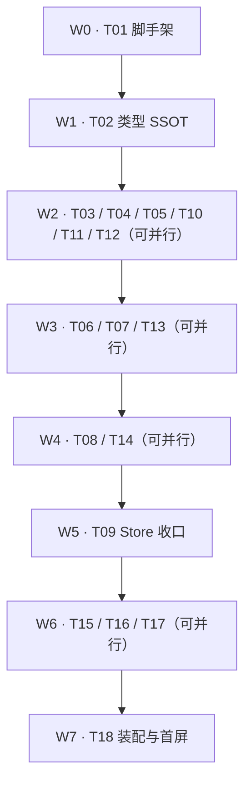

# 任务划分与执行指引

上游：`proposal.md` **V0.0.1-R2**（25 条 REQ / 25 条 AC）｜ `detailed-design.md` **V0.0.1-R1**（17 个模块）

共 **18 个任务**，每个任务文件对应一个可独立派发的执行单元，内含：允许改动的文件清单、接口契约、口径与严禁事项、验收条件、以及一段可直接粘贴给执行者的 prompt。

---

## 一、任务清单与依赖

| 任务 | 对应模块 | 产出文件 | 依赖 | 说明 |
|------|---------|---------|------|------|
| T01 | MOD-015 前半 | 工程配置 + `index.html` | — | 让 dev/build/test/typecheck 跑通 |
| T02 | MOD-001 | `core/types.ts` | T01 | **全项目 SSOT，最优先完成** |
| T03 | MOD-002 | `core/date.ts` | T02 | 跨度与日历口径（REQ-020） |
| T04 | MOD-003 | `core/id.ts` | T02 | id 生成 |
| T05 | MOD-007 | `core/capacity.ts` | T02 | 容量水位（REQ-024） |
| T06 | MOD-004 | `core/validate.ts` | T02,T03,T04 | 表单/导入两套校验 |
| T07 | MOD-006 | `core/select.ts` | T02,T03 | 排序筛选关联全部在 core 算完 |
| T08 | MOD-005 | `core/merge.ts` | T02,T03,T04,T06 | 合并与不变量裁剪 |
| T09 | MOD-008 | `core/store.ts` | T02~T08 | **先落盘后提交**的事务容器 |
| T10 | MOD-009 | `ui/platform.ts` | T02 | Port 实现、压缩、下载、剪贴板 |
| T11 | MOD-016 | `ui/dom.ts`、`ui/bind.ts` | T01,T02 | 安全 DOM 构造 + 一次性委托 |
| T12 | MOD-014 | `ui/styles/*.css` | T01 | 主题变量与组件样式 |
| T13 | MOD-017 | `ui/parts/toast/confirm/lightbox.ts` | T01,T11,T12 | 浮层三件套 |
| T14 | MOD-010 | `ui/render.ts`、`card.ts`、`yearGroup.ts` | T07,T11,T12 | 全量重绘 + 焦点滚动恢复 |
| T15 | MOD-013 | `ui/parts/filterBar.ts`、`yearNav.ts` | T07,T09,T11,T12 | 筛选与年份导航 |
| T16 | MOD-011 | `ui/parts/formModal.ts` | T06,T09,T10,T13 | 事件/记录表单 |
| T17 | MOD-012 | `ui/parts/importExport.ts` | T08,T09,T10,T13 | 导入导出弹窗 |
| T18 | MOD-015 后半 | `main.ts`、`public/data/events.json` | 全部 | 装配、首屏、示例种子 |

## 二、执行波次



**关键路径**：T01 → T02 → T06 → T08 → T09 → T16/T17 → T18。这条链上任一任务延期，整体就延期；其余任务可以并行填满。

**T02 是全局瓶颈**：所有 Core 与 UI 都 import 它。它的口径一变，下游全要改。因此它必须先定稿、且改动必须回写 `detailed-design.md`。

## 三、每个任务共同遵守的纪律

1. **只改 touchlist 内的文件**。需要改清单外的文件，先停下来报告，不许自行扩大范围。
2. **不许修改 `proposal.md` 与 `detailed-design.md`**。发现文档本身有错，报告而非擅自改。
3. **不许新增依赖**。工程依赖固定为 `vite` / `typescript` / `vitest` 三个。
4. **不许用 `innerHTML` 系列 API 渲染用户数据**（REQ-025）。
5. **不许在 `core/**` 里 import `ui/**`**，不许在 `core/**` 里碰 `window`/`document`/`localStorage`。
6. **交付必须贴真实输出**：测试命令的真实结果、typecheck 的真实结果。不接受「已完成」「应该可以」。
7. **遇到阻塞要报告**，不许猜一个实现糊过去。宁可停在阻塞上，也不许编造通过结果。
8. 每个任务收尾跑：`npm run typecheck` + （涉及 core 时）`npm run test`。

## 四、验收归属（AC → 任务）

| AC | 需求 | 主任务 | 复核方式 |
|----|------|--------|---------|
| AC-01 | REQ-001 两层与 20 条上限 | T09 / T16 | 单测 T11 + 手工 |
| AC-02 | REQ-002 事件必填 | T06 / T16 | 单测 V1/V2 + 手工 |
| AC-03 | REQ-003 记录必填 | T06 / T16 | 单测 V4~V6 + 手工 |
| AC-04 | REQ-004 删除确认与关联解除 | T09 / T13 / T16 | 单测 T10 + 手工 |
| AC-05 | REQ-005 星级口径 | T07 / T14 | 单测 S1~S3 |
| AC-06 | REQ-006 分类字典 | T06 / T09 / T16 | 单测 V17 + 手工 |
| AC-07 | REQ-007 即时持久化 | T09 / T10 | 单测 T7 + 手工 |
| AC-08 | REQ-008 种子一次性 | T09 / T18 | 单测 T2/T3 + 手工 |
| AC-09 | REQ-009 导出 | T09 / T10 / T17 | 单测 T14 + 手工往返 |
| AC-10 | REQ-010 导入两模式 | T08 / T09 / T17 | 单测 M1~M4 |
| AC-11 | REQ-011 预览与不变量 | T06 / T08 / T09 / T17 | 单测 M6~M10 + 手工 |
| AC-12 | REQ-012 分组与排序 | T07 / T14 | 单测 S4~S6 |
| AC-13 | REQ-013 折叠六项 | T14 | 手工 |
| AC-14 | REQ-014 展开条件 | T07 / T14 | 单测 S17~S19 + 手工 |
| AC-15 | REQ-015 三类筛选 | T07 / T15 | 单测 S7~S10 |
| AC-16 | REQ-016 搜索口径 | T07 / T15 | 单测 S11~S13 |
| AC-17 | REQ-017 锚点与回到顶部 | T15 | 手工 |
| AC-18 | REQ-018 灯箱 | T13 / T14 | 手工 |
| AC-19 | REQ-019 关联双向与上限 | T08 / T09 | 单测 T12/T13 + M7 |
| AC-20 | REQ-020 跨度口径 | T03 / T07 | 单测 D1~D13 |
| AC-21 | REQ-021 跳转与高亮 | T14 / T18 | 手工 |
| AC-22 | REQ-022 主题可替换 | T12 | 手工（改一个变量） |
| AC-23 | REQ-023 子路径部署 | T01 / T18 | 手工（部署后验 404） |
| AC-24 | REQ-024 单图上限与总水位 | T05 / T09 / T10 | 单测 C1~C7 + T9 |
| AC-25 | REQ-025 协议白名单与纯文本 | T06 / T11 / T14 | 单测 V7~V10 + 手工 XSS |

## 五、通用 Prompt 模板

各任务文件末尾已有定制 prompt。若需为新任务套用，按此骨架：

```
你是「个人历史时间轴」项目 T<编号> 任务的执行者，工作目录为项目根目录。

先读（只读，不要修改）：
- detailed-design.md 的 §<章节>（<你要用的契约>）
- proposal.md 的 REQ-<编号>（<你要满足的需求>）

任务：<一句话目标>

只允许创建/修改这些文件：
<touchlist>

硬性要求：
1. <从设计文档抄下来的、最容易做错的口径>
2. <边界值与其行为>
3. <依赖必须从哪个模块来，不许自己实现>

严禁：
- <越界范围>
- <引入依赖>
- <吞掉错误 / 猜实现>

完成标准：
- <可执行命令 + 期望输出>
- 不许只说"已完成"，必须贴真实输出
```

## 六、执行顺序建议

1. 先派 T01、T02，等 T02 定稿后再放并行。
2. W2、W3 六个任务可同时派，但 **T03（日期）与 T07（select）的接口要对齐**：`select` 依赖 `date.spanText` 的签名，签错会导致两处返工。
3. T09 Store 是全项目最重的一个，建议单独一轮、独占执行者，不要与其他任务同批派发。
4. T12 的 CSS 类名会被 T14/T15/T16 引用，若并行，先让 T12 交出类名清单。
5. T18 必须最后做，且必须在浏览器里真跑一遍首屏（不能只看 build 通过）。

## 七、已知风险点（执行时重点盯）

| 风险 | 表现 | 归属任务 |
|------|------|---------|
| 全量重绘丢焦点/滚动 | 搜索框打字时跳位、滚动位置乱跳 | T14 |
| 先改内存后落盘 | 配额超限后页面显示已保存、刷新丢失 | T09 |
| core 里 import ui | Core 单测跑不起来、循环依赖 | 全部 Core 任务 |
| 关键词搜索用正则 | `(` 等字符抛异常 | T07 |
| 日期用本地时区 | 换时区跨度天数变化 | T03 |
| 表单/导入共用一套校验 | 导入时整条被拒（数据丢失）或表单接受超长 | T06 |
| 合并做成记录级 | 产出既非本地也非导入的第三种状态 | T08 |
| 事件委托重复绑定 | 点一次卡片展开两次（等于没展开） | T11 |

## 八、验收执行方式与派发前置

**Core 任务（T02~T09）**：完成标准就是 Vitest 用例全绿，执行者贴 `npm run test` 与 `npm run typecheck` 的真实输出，没有解释空间。

**UI 任务（T10~T18）**：DOM 行为不可能靠执行者「手工点一遍」交付——它只会产出两种结果：编造一句「已验证」，或卡住等人工。因此统一改口径：

1. 执行者交付的是**可复现断言清单**：操作步骤、定位用的选择器或 `data-*` 键、期望的 DOM 或状态结果，随代码一起交出。
2. **DOM 断言由派发方用浏览器自动化复跑**（`browser_exec` / CDP），断言输出与截图作为验收证据。
3. 执行者不得自述「已验证」；它只需要贴 `npm run typecheck`（或 `npm run build`）的真实输出。

**派发前置**：除 T01 外，每个任务派发前确认项目根已有 `node_modules`（T01 之后跑过一次 `npm install`）。单独派发 T02 及以后的任务时，先补这一句，否则执行者会卡在 `tsc`/`vitest` 找不到命令。

## 九、本次 prompt 修订（v0.0.1-R2，2026-11-18）

改了什么：

- T18 装配顺序：代码块里 `bindActions` 与首次 `render` 的顺序颠倒（注释与 prompt 都说「必须在首次 render 之后」），已改为先 `render` 后 `bindActions`。
- T02：不再要求「照抄 §7.2 措辞」——§7.2 是场景表、不列 code 名；改为能对上的照抄、对不上的同风格自拟，不得因此停线。覆盖率改由 `Record<IssueCode, string>` 的类型检查保证，不再让人手工数。
- T10~T18：验收口径由「手工验 N 条」改为「交付可复现断言清单 + 派发方自动化复跑」。
- T13：解除「严禁 import core」与「必须用 §4.5 常量」的矛盾——常量必须从 `core/types` 导入，禁的是 store 与业务模块。
- T05：补上「已有 `data:` 配图时取实际均值」，否则 C7 必挂。
- T12：类名清单改为指向 §3 MOD-014（回写后设计文档已有类名表，任务文件里是副本）。
- T03：补方向前缀与「（共 N 天）」格式，要求 §6.7 四条样例逐字对上。
- T08：categories 并集这条 §6.3 已补写，prompt 里的「文档遗漏」注记已撤。
- T04：I4 的 1000 次去重改为固定 `nowMs` + 确定性伪随机序列，消除概率性失败。
- T06：用例计数写清（V1~V20 加 V3b/V3c 共 22 条）。
- T01：空目录占位文件统一 `.gitkeep`。

**已回写 `detailed-design.md` V0.0.1-R2（2026-11-18）**：

| 缺口 | 落点 | 状态 |
|------|------|------|
| `IssueCode` 无文案来源 | §7.2.1 新增 29 条 `code → 文案 → 严重度` 映射表，明确为 `ISSUE_MESSAGES` 唯一来源 | 已补 |
| CSS 类名与主题变量无契约 | §3 MOD-014 新增两张清单（变量 7 组、类名 6 组含四个状态类） | 已补 |
| 覆盖模式 `categories` 取并集未写 | §6.3 overwrite 分支 | 已补 |
| `id.spec.ts` 用例只在任务文件里 | §8.0 新增 I1、I2、I2b、I3、I4，并补 `rand` 值域与夹取规则 | 已补 |

**顺带修掉一个新发现的缺陷**：原 I2 用例写「`rand` 恒返回 0.999999 → 末 6 位 `zzzzzz`」，这条断言数学上不成立——`floor(0.999999 × 36^6)` 与 `36^6 − 1` 差 1175，断言必失败。已改为 `0.9999999999`，并补 I2b 覆盖 `rand` 返回 `1` 的越界注入（否则实现会产出 7 位）。T04 与 §3 MOD-003 同步加了夹取要求。
